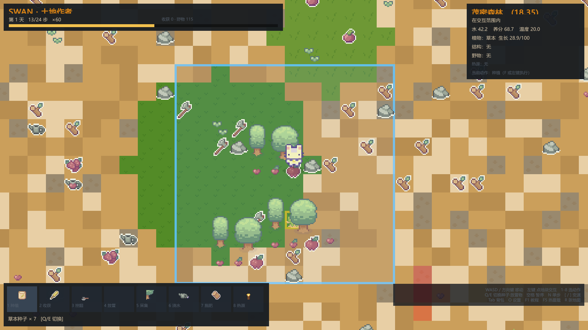
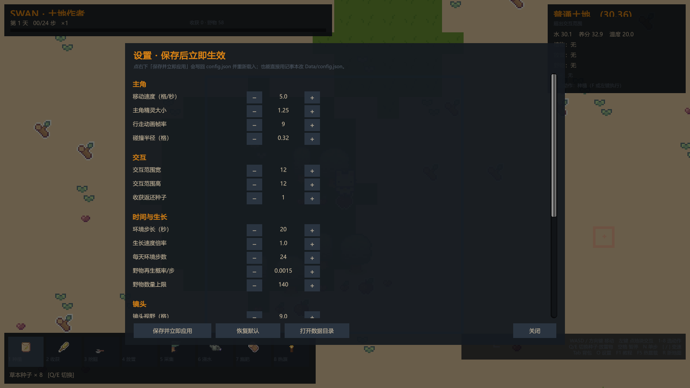

# SWAN 新手教程

> 目标：5 分钟知道怎么走、怎么点、怎么种、怎么改数值。
> 游戏里按 **F1** 也能看到同样的 7 步教程。

---

## 1. 启动

1. 打开 `swan-v01\Builds\` 文件夹。
2. 双击 `SwanV01.exe`（或双击工程根目录的 `开始游戏.bat`）。
3. 第一次会弹出「新手教程」，看完点 **开始游戏**。

如果双击没反应：

- 确认路径里没有正在被解压/占用；
- 远程桌面或虚拟机里没有显卡时，用命令行加 `-force-d3d11` 启动：
  `SwanV01.exe -force-d3d11`
- 还不行就看 `Builds\SwanV01_Data\` 是否存在；打包不完整时重新在 Unity 里执行
  **SWAN → 2 打包 Windows**。

---

## 2. 你在哪

- 白猫就是主角，**永远在画面正中间**。
- 猫周围有一圈 **浅蓝色方框**，框住 12×12 个格子，这就是你能点的范围。
- 右上角卡片显示鼠标指着的格子：地形、水、养分、温度、植物、放置物、野物、热源。
- 鼠标移出范围时，格子光标会变成**红色**，右上角写「超出交互范围」。

---

## 3. 走

| 按键 | 作用 |
|---|---|
| W / ↑ | 向上 |
| S / ↓ | 向下 |
| A / ← | 向左 |
| D / → | 向右 |

移动是连续的，撞到栅栏/箱子/营火会停下；水深超过 55 的格子不能走。

---

## 4. 点

1. 鼠标移到蓝框里的某个格子。
2. 按 **1–8** 选动作（屏幕下方动作栏会高亮）。
3. **左键点格子**，动作就执行了。

也可以不用点：鼠标悬停后按 **F**。

八个动作：

| 键 | 动作 | 做什么 |
|---|---|---|
| 1 | 种植 | 在空地种下当前种子（默认草本种子） |
| 2 | 收获 | 收成熟作物，进背包并返还种子 |
| 3 | 挖掘 | 降低水分/养分，获得 1 个泥土 |
| 4 | 放置 | 放下当前放置物（栅栏/木箱/营火/木地板） |
| 5 | 采集 | 收野果/蘑菇/花/木头；搬走岩石换石头；也能把放下的东西收回背包 |
| 6 | 浇水 | 水分 +12 |
| 7 | 施肥 | 消耗 1 个堆肥，养分 +10 |
| 8 | 热源 | 消耗 1 个营火，开/关该格热源 |

> 动作的数字、消耗、效果都在 `Data/数值表(动作表)-机读.csv` 里，不在代码里。

**岩石**：地图上会随机铺一些灰色岩石，挡路也挡种植。它们不是障碍物 bug：
按 **5 采集**、再点岩石，就能搬走并换回 1 个石头。想在设置里关掉，见 `改数值与美术.md` 的 `rockChance`。

---

## 5. 种一株草本（完整流程）

1. 按 **1**（种植）。
2. 找一块蓝框里的空地（右上角显示「植物：无」）。
3. 左键点它。底部会提示「种下草本种子（剩 7）」。
4. 按 **]** 把倍速调到 ×60，等土地自己走环境步。
5. 右上角「植物：草本 生长 xx/100」。
6. 生长到 100 后，按 **2**（收获），再点它。
7. 按 **Tab** 看背包：`产物` 和 `草本种子` 都变多了。

> 水/养分不够时植物会停长。按 **6** 浇水、按 **7** 施肥可以救。
> 土地太干时，地形会自己从「普通土地」变成「旱地」，这是设计的一部分。

---

## 6. 背包、种子、放置物

- **Tab**：打开/关闭背包。采集、挖掘、收获都会进背包。
- 选中「种植」时，**Q / E** 切换种子。
- 选中「放置」时，**Q / E** 切换放置物。
- 动作栏下面那行字显示当前物品和数量。

---

## 7. 改设置（不用改代码）

1. 按 **O** 打开设置面板。
2. 每项左边是 **−**，右边是 **+**。
3. 改完点 **保存并立即应用**。

最常用的几项：

| 想改什么 | 设置项 | 默认 |
|---|---|---|
| 走得太慢/太快 | 主角 → 移动速度（格/秒） | 5 |
| 猫太大/太小 | 主角 → 主角精灵大小 | 1.25 |
| 想点更远 | 交互 → 交互范围宽 / 高 | 12 / 12 |
| 作物长得太慢 | 时间与生长 → 生长速度倍率 | 1.0 |
| 想看得更远 | 镜头 → 镜头视野（格） | 9.0 |
| 想换一张地图 | 地图 → 地图种子 / 宽 / 高 | 20261118 / 50 / 50 |
| 嫌岩石太多/太少 | 地图 → 岩石密度（0=关闭） | 0.018 |

> 地图类改动（种子/宽/高/岩石密度）保存后，还要在游戏里按 **R** 重建地图才生效；
> 这会重置地形、野物和岩石。只改移动/交互/界面等参数则保存后立刻生效。

「保存并立即应用」会把数值写进：

- 打包版：`Builds\SwanV01_Data\StreamingAssets\Data\config.json`
- 编辑器：`Assets\StreamingAssets\Data\config.json`

也可以点 **打开数据目录** 直接看到这些文件。

---

## 8. 暂停与时间

- **空格**：暂停/继续。
- **N**：暂停状态下也推进 **1 个环境步**，适合观察土地变化。
- **[ / ]**：倍速档位来自 `config.json` 的 `speedLevels`（默认 1 / 10 / 60）。
- 顶部「第 X 天 00/24 步」：一天 = 24 个环境步（`envStepsPerDay`）。

---

## 9. 常见问题

**点了没反应？**
- 看右上角是不是「超出交互范围」；
- 看底部提示：可能没有种子/没有堆肥/格子上已经有东西；
- 教程/背包/设置面板打开时，世界操作会暂停（时间仍在走），先按 Esc 关面板。

**植物不长？**
- 右上角看水、养分是否低于门槛（草本要水 ≥20、养分 ≥15、温度 5–40）；
- 按 6 浇水、7 施肥；
- 倍速是不是 ×1？按 ] 提高。

**画面全黑/进不去？**
- 用 `SwanV01.exe -force-d3d11` 启动；
- 更新显卡驱动；
- 确认 `Builds\SwanV01_Data` 和 exe 在同一个文件夹。

**想从头开始？**
- 按 **R**，会按 `map-preset.json` 重建地图；
- 或在设置里改「地图种子」，保存并应用。

**想恢复所有默认数值？**
- 设置面板 → **恢复默认**（读 `config.default.json`）。
